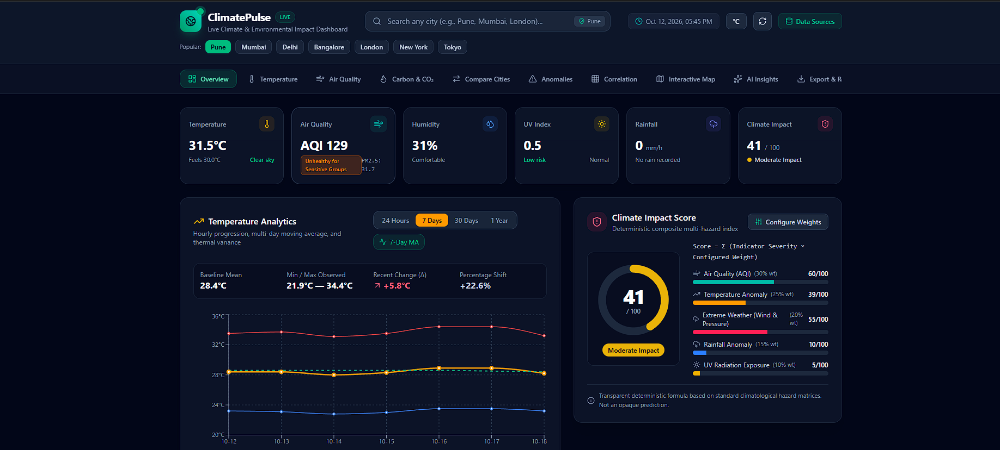
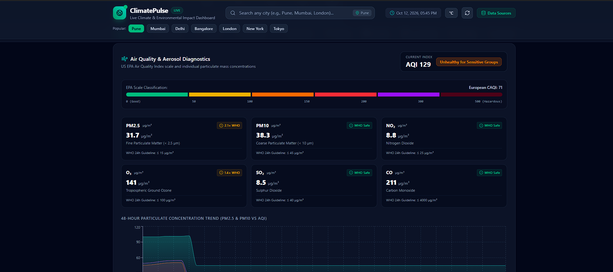

# ClimatePulse — Live Climate Impact Dashboard

<div align="center">


**A high-precision, real-time climate and environmental analytics platform tracking global weather, air quality index (AQI), aerosol particulate matter, atmospheric CO₂ accumulation, statistical anomalies, and deterministic multi-hazard risk scores.**

[Features](#-key-features) • [Screenshots](#-project-previews) • [Architecture](#-system-architecture--data-pipeline) • [Setup & Installation](#-quickstart--installation) • [API Reference](#-api-endpoints) • [Methodology](#-scientific--analytical-methodology)

</div>

---

## 📸 Project Previews

### 1. Live Dashboard Overview & Climate Impact Score
> Displays real-time atmospheric telemetry, dynamic KPI cards, 7-day temperature trends with moving averages, and the transparent composite Climate Impact Score gauge.

<div align="center">
  
  <p><em>Overview tab showing Pune live conditions (31.5°C, AQI 129 Unhealthy for Sensitive Groups, 7-day temperature trend with moving average, and 41/100 Moderate Impact Score).</em></p>
</div>

---

### 2. Air Quality & Aerosol Diagnostics
> Detailed particulate breakdown against World Health Organization (WHO) 24-hour guidelines, European CAQI classification, and 48-hour continuous concentration trends.

<div align="center">
  
  <p><em>Air Quality Diagnostics view displaying PM2.5 (31.7 µg/m³ — 2.1× WHO), PM10 (38.3 µg/m³), NO₂ (8.8 µg/m³), O₃ (141 µg/m³ — 1.4× WHO), SO₂, and CO levels alongside 48-hour aerosol trend graphs.</em></p>
</div>

*(Note: When cloning to GitHub, keep the screenshots in `docs/images/dashboard-overview.png` and `docs/images/air-quality-diagnostics.png` or directly in the repository root.)*

---

## 🌟 Key Features

### 1. Real-Time Meteorological & Atmospheric Telemetry
- **Physical Metrics**: Temperature (°C/°F), Apparent ("Feels like") temperature, Relative Humidity (%), Surface Barometric Pressure (hPa), Wind Speed & Direction, Precipitation rate (mm/h), UV Index, and official WMO meteorological state decoding.
- **Global Geocoding & City Search**: Search any city worldwide with autocomplete (e.g. Pune, Mumbai, Delhi, Bangalore, London, New York, Tokyo, Paris).
- **Auto-Refresh**: Live data refreshes automatically every 5 minutes with manual refresh controls and live timestamp audits.

### 2. Air Quality Index & Chemical Pollutant Profiling
- **EPA AQI & European CAQI**: Standardized 6-tier classification (Good, Moderate, Sensitive, Unhealthy, Very Unhealthy, Hazardous).
- **Comprehensive Pollutant Suite**:
  - **PM2.5** (Fine respirable particulate matter)
  - **PM10** (Inhalable coarse particulate matter)
  - **NO₂** (Nitrogen Dioxide from combustion)
  - **O₃** (Ground-level tropospheric photochemical ozone)
  - **SO₂** (Sulphur Dioxide industrial emissions)
  - **CO** (Carbon Monoxide)
- **WHO Benchmark Auditing**: Instant compliance tags indicating safe levels or multiples above 24-hour WHO thresholds (e.g., $2.1\times\text{ WHO}$).

### 3. Deterministic Climate Impact Score (0–100)
- **Mathematical Composite Index**:
  $$\text{Score} = \frac{W_{\text{AQI}} \cdot S_{\text{AQI}} + W_{\text{Temp}} \cdot S_{\text{Temp}} + W_{\text{Extreme}} \cdot S_{\text{Extreme}} + W_{\text{Rain}} \cdot S_{\text{Rain}} + W_{\text{UV}} \cdot S_{\text{UV}}}{\sum W_i}$$
- **Configurable Weights**:
  - Air Quality Severity: **30%**
  - Temperature Anomaly: **25%**
  - Extreme Weather (Wind & Pressure volatility): **20%**
  - Rainfall Anomaly: **15%**
  - UV Radiation Exposure: **10%**
- **User-Adjustable Weights**: Users can tweak weights using interactive sliders and watch the score recalculate live with complete mathematical transparency.

### 4. Advanced Temperature & Climate Analytics
- **Multi-Horizon Timeframes**: Toggle seamlessly between **24 Hours (hourly), 7 Days (daily), 30 Days, and 1 Year**.
- **Moving Averages**: 7-Day moving average curve to eliminate day-to-day noise and reveal macro trends.
- **Statistical Variance**: Displays historical mean, min/max bands, absolute temperature changes ($\Delta$), and percentage shifts.

### 5. Statistical Anomaly & Extreme Event Detection
- **Z-Score Outlier Isolation**: Standardized residuals $z = \frac{x - \mu}{\sigma}$ flagging observations with $|z| \ge 2.0$.
- **Interquartile Range (IQR)**: Outlier upper boundary isolation ($Q_3 + 1.5 \times \text{IQR}$).
- **Multi-Hazard Flags**: Barometric pressure drops (cyclonic storms), heat spikes, and flash deluge alerts with severity tags (*Moderate, High, Extreme*).

### 6. Pearson Correlation Heatmap Matrix
- Computes pairwise Pearson correlation coefficients ($r$) between Temperature, AQI, Humidity, Rainfall, UV Index, and Wind Speed.
- Interactive cell inspection explaining atmospheric mechanisms.
- Transparent disclaimer: *Statistical associations indicate observed covariance and do not imply causal mechanisms.*

### 7. Global Atmospheric CO₂ Diagnostics (NOAA GML)
- Monthly observational benchmark time-series from the Mauna Loa Observatory (~427 ppm).
- **Critical Scientific Distinction**: Clearly distinguishes well-mixed **atmospheric background CO₂ concentration (ppm)** from **localized anthropogenic annual greenhouse gas emissions (Mt CO₂)**.

### 8. Interactive Geospatial Environmental Map (Leaflet)
- High-contrast dark CartoDB basemap with color-coded sensor markers.
- Switchable layers: **AQI, Temperature, Rainfall, UV Index**.
- Popups featuring live statistics and single-click dashboard city selection.

### 9. AI Climate Insights (Google Gemini)
- Automated narrative synthesis powered by Google Gemini (`gemini-3.8-flash`) via the `@google/genai` TypeScript SDK.
- Strictly grounded in computed telemetry without hallucinating fake data.
- Deterministic analytical fallback engine when offline or if an API key is not supplied.

### 10. Data Export & Printable Executive Briefs
- Download machine-readable **CSV, Excel (.xls/.csv), and JSON** datasets.
- Clean printable Executive Climate Summary report view.

### 11. Admin & Data Quality Monitoring
- Validates data against physical limits ($-90^\circ\text{C} \le T \le 60^\circ\text{C}$, $0 \le \text{AQI} \le 500$, non-negative precipitation).
- Ingestion pass-rate score, API uptime indicators, and validation audit log tables.

---

## 🏛 System Architecture & Data Pipeline

```
┌──────────────────────────────────────────────────────────┐
│                   Verified Public APIs                   │
│   • Open-Meteo Weather API    • Open-Meteo Air Quality   │
│   • Open-Meteo Geocoding API  • NOAA Mauna Loa GML CO₂   │
└─────────────────────────────┬────────────────────────────┘
                              │
                              ▼
┌──────────────────────────────────────────────────────────┐
│             Data Ingestion & Caching Layer              │
│       • In-memory TTL cache (rate-limit protective)      │
│       • Multi-city parallel fetching                     │
└─────────────────────────────┬────────────────────────────┘
                              │
                              ▼
┌──────────────────────────────────────────────────────────┐
│              Data Quality & Validation Engine            │
│       • Terrestrial physical atmospheric boundaries      │
│       • Missing / corrupt field sanitization             │
│       • Audit log generation for admin telemetry         │
└─────────────────────────────┬────────────────────────────┘
                              │
                              ▼
┌──────────────────────────────────────────────────────────┐
│                    Analytics Engine                      │
│       • Descriptive statistics (Mean, StdDev, Quantiles) │
│       • 7-Day & 30-Day Rolling Moving Averages           │
│       • Z-Score & IQR Statistical Anomaly Detection      │
│       • Pearson Correlation Matrix Calculation           │
│       • Deterministic Climate Impact Composite Scoring   │
└─────────────────────────────┬────────────────────────────┘
                              │
                              ▼
┌──────────────────────────────────────────────────────────┐
│             AI Insight Synthesis (Gemini API)            │
│       • Prompt engineered with factual analytics metrics │
│       • Deterministic analytical rule fallback engine    │
└─────────────────────────────┬────────────────────────────┘
                              │
                              ▼
┌──────────────────────────────────────────────────────────┐
│               Full-Stack REST & Presentation             │
│       • Express / FastAPI endpoints (/api/*)             │
│       • React 19 + TypeScript + Tailwind CSS UI          │
│       • Recharts Data Visualizations + Leaflet Maps      │
└──────────────────────────────────────────────────────────┘
```

---

## 💻 Tech Stack

| Domain | Technologies |
|---|---|
| **Frontend** | React 19, TypeScript, Tailwind CSS v4, Lucide React, Motion |
| **Charts & Maps** | Recharts, Leaflet |
| **Backend** | Node.js (Express) + Python 3.10 (FastAPI alternative) |
| **Analytics Engine** | High-precision TypeScript Math Engine + Python (Pandas, NumPy, Scikit-learn) |
| **AI Integration** | Google Gemini 3.8 Flash (`@google/genai` TypeScript SDK) |
| **Database** | PostgreSQL (DDL schema & migrations in `schema.sql`) |
| **Testing** | Node/TypeScript test runner + Python `unittest` |
| **Containerization** | Docker (multi-stage Alpine), Docker Compose |

---

## 🚀 Quickstart & Installation

### Option 1: Running the Full-Stack Application (Node.js + React + Express)

#### Prerequisites
- Node.js 20+ installed
- npm or bun

#### 1. Clone & Install Dependencies
```bash
git clone https://github.com/<YOUR-USERNAME>/climatepulse.git
cd climatepulse
npm install
```

#### 2. Configure Environment Variables
Copy `.env.example` to `.env`:
```bash
cp .env.example .env
```

Edit `.env` (optional, the dashboard works out-of-the-box using the deterministic analytics fallback):
```env
GEMINI_API_KEY="your-gemini-api-key"
PORT=3000
```

#### 3. Run Automated Unit Tests
```bash
npm test
```
*Executes unit tests verifying mean, standard deviation, moving averages, Pearson correlation, and anomaly detectors.*

#### 4. Start the Application
```bash
npm run dev
```
Open **[http://localhost:3000](http://localhost:3000)** in your browser.

---

### Option 2: Running with Docker Compose (App + PostgreSQL)

```bash
docker compose up -d --build
```
This starts:
1. The ClimatePulse full-stack web service on `http://localhost:3000`.
2. A healthy PostgreSQL 16 database pre-seeded with `schema.sql` on `localhost:5432`.

---

### Option 3: Running the Python FastAPI Backend

```bash
# Create and activate virtual environment
python3 -m venv venv
source venv/bin/activate

# Install dependencies
pip install -r backend/requirements.txt

# Run Python unit tests
python -m unittest tests/test_analytics.py

# Launch FastAPI server with Swagger docs
uvicorn backend.app.main:app --host 0.0.0.0 --port 8000 --reload
```
Access interactive OpenAPI / Swagger documentation at `http://localhost:8000/docs`.

---

## 🗄 Database Design (PostgreSQL)

Execute `schema.sql` against your PostgreSQL database:
```bash
psql -U postgres -d climatepulse -f schema.sql
```

The database schema includes:
- **`locations`**: Geocoded cities, administrative country metadata, latitudes, longitudes, and timezones.
- **`climate_data`**: Time-series meteorological records with check constraints (`-90 <= temperature <= 60`, `rainfall >= 0`).
- **`air_quality`**: Concentration readings for PM2.5, PM10, CO, NO₂, SO₂, O₃, and US AQI.
- **`climate_insights`**: Audit logs of AI and analytics-generated risk assessments.

---

## 📡 API Endpoints Reference

| Method | Endpoint | Query Parameters | Description |
|---|---|---|---|
| `GET` | `/api/climate/current` | `city=Pune` | Current weather, AQI, impact score, and status |
| `GET` | `/api/climate/history` | `city=Pune&days=14` | Hourly & daily historical time series with 7-day MA |
| `GET` | `/api/air-quality` | `city=Pune` | Pollutant concentrations & 48-hour aerosol trend |
| `GET` | `/api/compare` | `cities=Pune,Mumbai,Delhi` | Side-by-side comparative environmental matrix |
| `GET` | `/api/anomalies` | `city=Pune` | Statistical outliers flagged via Z-score & IQR |
| `GET` | `/api/insights` | `city=Pune` | Gemini AI-generated narrative insights |
| `GET` | `/api/correlation` | `city=Pune` | Pearson correlation matrix across 6 metrics |
| `GET` | `/api/locations` | `query=London` | Geocoding city search suggestions |
| `GET` | `/api/carbon` | — | NOAA Mauna Loa atmospheric CO₂ benchmark |
| `GET` | `/api/admin/health` | — | System health, API uptime, data quality metrics |
| `GET` | `/api/export/:format` | `city=Pune` (csv/excel/json) | Downloadable data export files |

---

## 🔬 Scientific & Analytical Methodology

### 1. Z-Score Anomaly Detection
$$z = \frac{x - \mu}{\sigma}$$
- Where $x$ is the current observation, $\mu$ is the baseline 14-day sample mean, and $\sigma$ is the sample standard deviation.
- Thresholds:
  - $|z| \ge 2.0$: **Moderate Anomaly** (top 4.5% occurrence)
  - $|z| \ge 2.5$: **High Anomaly**
  - $|z| \ge 3.0$: **Extreme Anomaly** (top 0.3% occurrence)

### 2. Pearson Correlation Coefficient ($r$)
$$r = \frac{\sum (x_i - \bar{x})(y_i - \bar{y})}{\sqrt{\sum (x_i - \bar{x})^2 \sum (y_i - \bar{y})^2}}$$
Calculates pairwise linear correlation across 336 hourly observations.

### 3. Transparent Composite Impact Score
The Climate Impact Score combines 5 normalized sub-indices ($S_i \in [0, 100]$):
1. **Air Quality ($S_{\text{AQI}}$)**: Scaled non-linearly from US EPA AQI breakpoints.
2. **Temperature Anomaly ($S_{\text{Temp}}$)**: Absolute deviation $|T - \mu_T|$ normalized to regional variance.
3. **Extreme Weather ($S_{\text{Extreme}}$)**: Wind gust severity and barometric pressure departures from $1013.25\text{ hPa}$.
4. **Rainfall Anomaly ($S_{\text{Rain}}$)**: Flash deluge intensity or prolonged arid drought stress.
5. **UV Exposure ($S_{\text{UV}}$)**: Scaled according to WHO Global Solar UV Index bands.

---

## 🌐 Public Data Sources & Standards

| Source | Domain | Endpoint / Organization | Update Frequency |
|---|---|---|---|
| **Open-Meteo Weather API** | Meteorology | `api.open-meteo.com` | Hourly model runs (ICON, GFS, ECMWF) |
| **Open-Meteo Air Quality** | Aerosols & Chemistry | `air-quality-api.open-meteo.com` | Hourly (Copernicus CAMS models) |
| **Open-Meteo Geocoding** | Spatial Search | `geocoding-api.open-meteo.com` | Real-time |
| **NOAA GML** | Atmospheric CO₂ | Mauna Loa Baseline Observatory | Monthly continuous spectrometry |

---

## 🚢 Production Deployment

### Deploy to Render
1. Connect your GitHub repository at [render.com](https://render.com).
2. Set **Build Command**: `npm install && npm run build`
3. Set **Start Command**: `npm start`
4. Set Environment Variables: `NODE_ENV=production`, `PORT=10000`, `GEMINI_API_KEY=YOUR_KEY`

### Deploy to Railway
1. New Project → Deploy from GitHub Repo.
2. Railway detects the `Dockerfile` automatically.
3. Add environment variables and click **Deploy**.

### Deploy to Google Cloud Run
```bash
gcloud run deploy climatepulse \
  --source . \
  --platform managed \
  --region us-central1 \
  --allow-unauthenticated \
  --set-env-vars NODE_ENV=production,PORT=8080
```

---

## 📄 License
Distributed under the Apache-2.0 License.
# climatepulse

